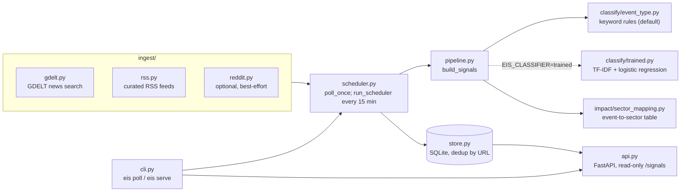

# event-impact-signals

[](https://github.com/shaikn6/event-impact-signals/actions/workflows/ci.yml)
[](LICENSE)
[](pyproject.toml)

**A research tool that classifies real-world events (war, natural disaster,
pandemic, trade dispute, monetary policy, energy shock, labor strike,
cyberattack, mergers & acquisitions, supply chain disruption) from live
news, and maps each one to the sectors it has historically tended to help
or hurt — with a direction, confidence, and a one-line rationale for
every impact it reports.**

Classification is a deterministic keyword-rule classifier by default (an
opt-in TF-IDF + logistic-regression model is described under
[Evaluation](#evaluation)); the event-to-sector mapping is a hand-curated
table. To run it, see [Quickstart](#quickstart).

**This is a signal/research surface, not investment advice.** Every output
is a documented hypothesis ("war raises defense spending and oil-supply
risk, so defense and energy tend up") based on historical patterns, not a
calibrated probability or a recommendation to buy or sell anything. It
never places trades, never executes anything, and the API is read-only.

## The idea

One event rarely affects the whole market the same way — it reshuffles
winners and losers. A war is bad for airlines and tourism but tends to be
good for defense contractors and energy producers. A pandemic hurts travel
but helps pharma and remote-work software. A rate hike helps bank margins
but hurts real estate and growth-tech valuations. This project surfaces
that reshuffling as structured data instead of leaving it as something
you have to reason through by hand for every headline.

Example: a real BBC World headline from a live poll on 2026-10-28, run
through the default keyword classifier on its **title alone** (the poller
classifies title plus RSS summary, which can score differently). After
`pip install -e .`:

```bash
python - <<'EOF'
import json
from eis.models import Article
from eis.pipeline import build_signal

article = Article(
    title="Ceasefire extended across Ukraine's Kherson region, officials say",
    url="https://www.bbc.co.uk/news/articles/c6lye1w9p2l8o",
    source="rss:bbc_world",
)
print(json.dumps(build_signal(article).to_dict(), indent=2))
EOF
```

Output, pasted from that run:

```json
{
  "title": "Ceasefire extended across Ukraine's Kherson region, officials say",
  "url": "https://www.bbc.co.uk/news/articles/c6lye1w9p2l8o",
  "source": "rss:bbc_world",
  "country": null,
  "published_at": null,
  "event_type": "war_conflict",
  "event_confidence": 0.33,
  "sector_impacts": [
    {
      "sector": "defense",
      "direction": "up",
      "confidence": 0.8,
      "rationale": "Military spending rises during active conflicts."
    },
    {
      "sector": "energy_oil_gas",
      "direction": "up",
      "confidence": 0.7,
      "rationale": "Supply-disruption risk pushes oil/gas prices up."
    },
    {
      "sector": "gold_safe_haven",
      "direction": "up",
      "confidence": 0.6,
      "rationale": "Flight-to-safety demand rises during conflict."
    },
    {
      "sector": "airlines",
      "direction": "down",
      "confidence": 0.7,
      "rationale": "Route disruption and fuel-cost spikes hurt margins."
    },
    {
      "sector": "tourism_hospitality",
      "direction": "down",
      "confidence": 0.6,
      "rationale": "Safety concerns reduce travel to the region."
    },
    {
      "sector": "shipping_freight",
      "direction": "mixed",
      "confidence": 0.5,
      "rationale": "Rerouting raises rates but adds cost and risk."
    }
  ]
}
```

`event_confidence` 0.33 means one matched keyword ("ceasefire"); confidence
saturates at three. The example also shows a real limit: the keyword rules
do not tell escalation from de-escalation, so a ceasefire still maps to the
war-conflict impact table.

## How it works



- **Ingest** — pulls live articles from [GDELT](https://blog.gdeltproject.org/gdelt-doc-2-0-api/)
  (free, global news search, no API key), a curated RSS list (BBC,
  MarketWatch, Fox Business), and optionally Reddit (best-effort — see
  caveat below).
- **Classify** — by default a deterministic keyword-rule classifier
  (`classify/event_type.py`); an opt-in trained model is described under
  Evaluation. Every category is an
  explicit, auditable list of trigger phrases, scored by phrase
  specificity so e.g. "trade war" correctly outweighs the bare word "war"
  it contains. This trades some recall for the thing a research tool
  needs most: every output traces back to *why* it fired.
- **Impact** — `impact/sector_mapping.py` is a hand-curated lookup table,
  not a trained model. It's deliberately data, not code, so the mapping
  itself can be read, debated, and extended without touching any logic.
- **Store + API** — new signals are deduplicated by URL into SQLite;
  FastAPI serves them read-only at `/signals`. `eis poll`, the `eis serve`
  poller and its API all use the same `--db-path` (default
  `data/signals.db`, relative to the current directory).

## Evaluation

The event classifier is measured on a small hand-labeled set of 34 headlines
(`eval/eval_set.jsonl`): two to three per event type, four `general`
("no tradable event") headlines, and four idiomatic **trap** headlines whose
true label is `general` ("retailers enter a price war", "a flood of new
streaming shows", "the board sanctions a buyback", "startup hacked together a
prototype") so the score is not inflated by only clear keyword hits.

`python eval/evaluate.py` (committed output in `eval/results.json`):

- **Accuracy 70.6% (24 / 34).**
- **Precision-oriented, recall-limited.** When it fires a category it is
  usually right — precision is 1.0 for most event types — but it falls back
  to `general` whenever its exact trigger words are absent, so recall on the
  rarer-phrased categories is around 0.5. That is the keyword tradeoff, by
  design, not a bug.
- **Two of the three word-level traps misfired**, exactly as the code's own
  comments flag as an unconfirmed risk: "price war" scored `war_conflict`
  and "the board sanctions a buyback" scored `regulatory_sanction`. This
  eval confirms that polysemy risk; it has not been patched (the project
  only changes a keyword for a failure seen in live flow — see below).

This is a sanity check on 34 synthetic-but-realistic headlines, not a
benchmark on live news. It measures the keyword classifier only.

### Trained classifier vs keyword rules

An opt-in trained classifier (`classify/trained.py`) is a TF-IDF (1-2 grams)
plus logistic-regression model, fit on a **hand-labeled set of 181
headlines** (`eval/train_set.jsonl`: 12 per event type, 37 `general`
including idiom traps). The headlines were written by hand by the
repo author; they are realistic but synthetic, not scraped news, and no public dataset was used
because none maps onto these 13 classes (labor strikes, supply-chain
disruption and so on). The regularisation strength was picked by 5-fold
cross-validation inside the training set only.

Both classifiers are scored on the same **108 held-out headlines** (the
original 34 plus 74 new ones in `eval/test_extra.jsonl`; none appear in the
training set, and `evaluate_trained.py` asserts that):

| Held-out test (n=108) | Accuracy | Macro-F1 |
|---|---|---|
| Always predict `general` | 20.4% | 0.026 |
| Keyword rules (default) | 44.4% (48/108) | 0.467 |
| Trained TF-IDF + LR | 76.9% (83/108) | 0.771 |

On the original 34-headline set alone: keyword 70.6% (macro-F1 0.747),
trained 88.2% (macro-F1 0.867).

Read this with care:

- The 74 new test headlines were not tuned to the keyword list, so
  many use wording the rules do not contain; that is why keyword
  accuracy falls from 70.6% to 44.4% on the larger set. A test built
  from live news would give different numbers for both models.
- Training and test headlines share one author and one style, and the
  idiom traps ("price war", "a flood of ...") appear in both, so the
  trained score is probably optimistic for real headlines.
- 108 test rows is small; one headline is about 0.9 points. 25 headlines
  are still wrong, and the trained model misses clear single-keyword cases
  the rules catch (for example "Ransomware attack forces the school
  district to cancel classes" -> `general`). A hybrid of the two is an
  obvious next step and is not built.
- Confidence is a softmax probability and is not calibrated.

Reproduce: `python eval/train_classifier.py` (needs scikit-learn, in the
`dev` extra) rewrites the 329 KB weight file `src/eis/classify/event_clf.json`;
`python eval/evaluate_trained.py` rewrites `eval/results_comparison.json`.
The runtime scorer is pure Python on that JSON (no pickle, no
scikit-learn at inference). Opt in with `EIS_CLASSIFIER=trained`; the
keyword classifier remains the default.

## Known limitations (read before trusting any output)

- **The default event classifier is keyword-based, not NLP.** It will miss events
  phrased without any of its trigger words, and a sarcastic or
  speculative headline ("could a war save the auto industry?") can fire
  the same as a real one. Confirmed live and fixed: "combat" alone used
  to trigger WAR_CONFLICT, misfiring on idiomatic headlines like "checks
  to help combat inflation" — it's been removed from the keyword list in
  favor of the more specific phrases already there.
- **Some event categories are genuinely lower-frequency than others in
  real news flow, independent of classifier quality.** War, natural
  disaster, and pandemic coverage show up reliably within a single poll;
  merger/acquisition and supply-chain-disruption headlines were absent
  across three separate live test runs on this project's own
  development day even with a widened 40-article GDELT sampling window
  per query — not because the keywords are wrong (unit tests confirm
  exact-match behavior for realistic headline phrasing), but because
  those stories just don't break as continuously globally. Don't read a
  quiet poll cycle for those categories as evidence the classifier is
  broken.
- **The sector-impact table encodes historical patterns, not guarantees.**
  A given real event can break any rule in it — a short, contained
  conflict with no supply disruption doesn't move oil the way a
  prolonged one does. Confidence reflects how reliably the pattern has
  held historically, not the probability of a specific outcome.
- **Reddit ingestion is unreliable.** Reddit's public `.json` endpoints
  reject unauthenticated requests from some networks (observed: HTTP
  403). It's off by default (`--include-reddit` to try it) and a failed
  fetch is treated as "no new posts," never as an error. For reliable
  Reddit data, register a free API app and switch `ingest/reddit.py` to
  OAuth — that's a documented upgrade path, not implemented here.
- **GDELT still rate-limits at the 5-second spacing, and some queries
  are lost.** GDELT asks for one request per ~5 seconds and the scheduler
  spaces its 7 queries accordingly (don't lower
  `_GDELT_REQUEST_SPACING_SECONDS` without checking GDELT's current
  terms), but that does not prevent HTTP 429: in live polls on
  2026-10-28, 4 to 6 of the 7 first attempts got 429. Each 429 is now
  logged and retried at most twice (waiting for `Retry-After` if GDELT
  sends one, capped at 60 s, otherwise 10 s then 20 s); a query still
  throttled after that is dropped for the cycle. The poll summary line
  reports both, e.g. `GDELT 429 responses: 13, queries dropped: 3 of 7`
  from a live poll where the retries recovered 3 of the 6 throttled
  queries.
- **A poll cycle takes about two minutes without throttling and longer
  with retries, dominated by GDELT, not by sleep overhead.**
  Measured against the live API, GDELT's own response time regularly
  runs ~12-14s per request even when it succeeds, and the required
  spacing forces the 7 requests to stay sequential against the same
  host; the retry waits above add to that (the throttled poll quoted
  above took 6 min 25 s). The
  independent RSS fetch runs concurrently with all of that instead of
  after it, and the 7 GDELT queries share one `httpx.Client` connection
  to avoid a repeated TLS handshake — real but modest savings (RSS
  typically finishes in well under a second), not a fix for GDELT's own
  latency. `fetch_articles`'s default timeout is 25s, not the more usual
  10s, specifically because a 10s timeout was measured silently
  discarding good, slow-but-successful GDELT responses as failures.

## Quickstart

macOS note: with the python.org installer, Python's own TLS (used by
`feedparser`) fails certificate verification until certificates are
installed, so every RSS feed returns 0 articles; the poller now logs a
warning per feed instead of staying silent. GDELT goes through `httpx` and
its bundled certificates, so it is not affected. Run
`/Applications/Python 3.x/Install Certificates.command` once (3.x is your
version), or set `SSL_CERT_FILE=/etc/ssl/cert.pem`.

```bash
pip install -e ".[dev]"

# One ingest/classify/store cycle, then exit:
eis poll

# Live: background poller (every 15 min, matching GDELT's update cadence)
# + a read-only API on :8000:
eis serve
curl http://localhost:8000/signals | python3 -m json.tool
```

## Tests

```bash
pytest tests/ -q
```

All network calls are mocked in tests (`respx` for HTTP, `monkeypatch` for
`feedparser`) — the suite runs in about 2 seconds on an M2 Pro, needs no
live network access or API keys, and writes its SQLite files under
pytest's temporary directories, so it leaves nothing in the repo.

## License

MIT.
